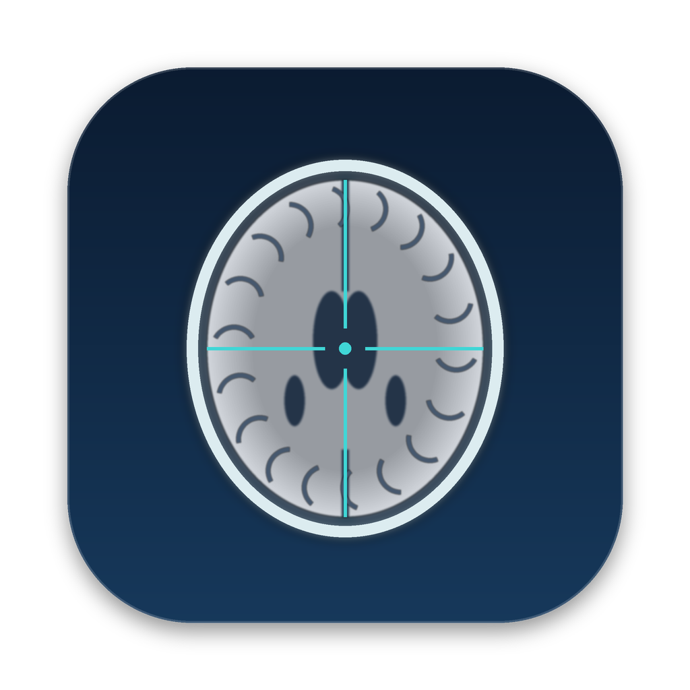
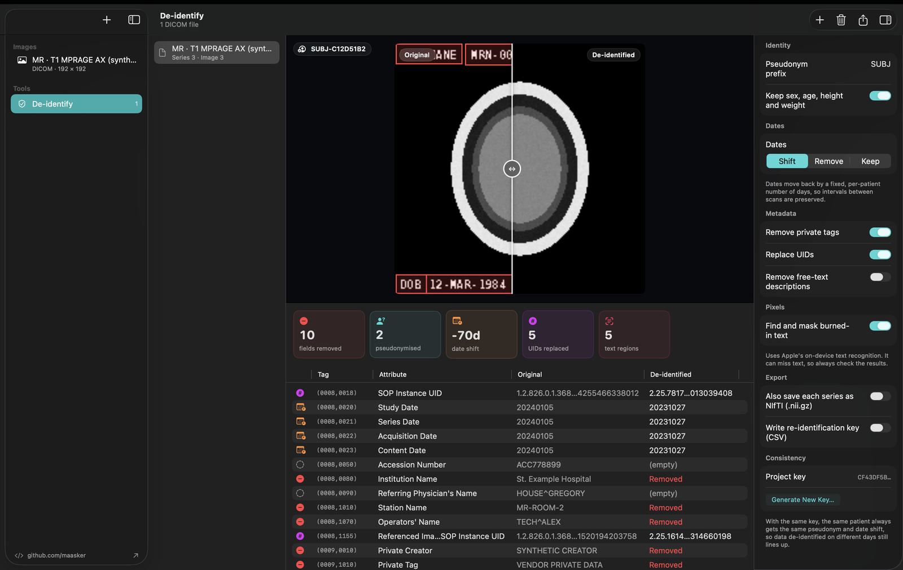
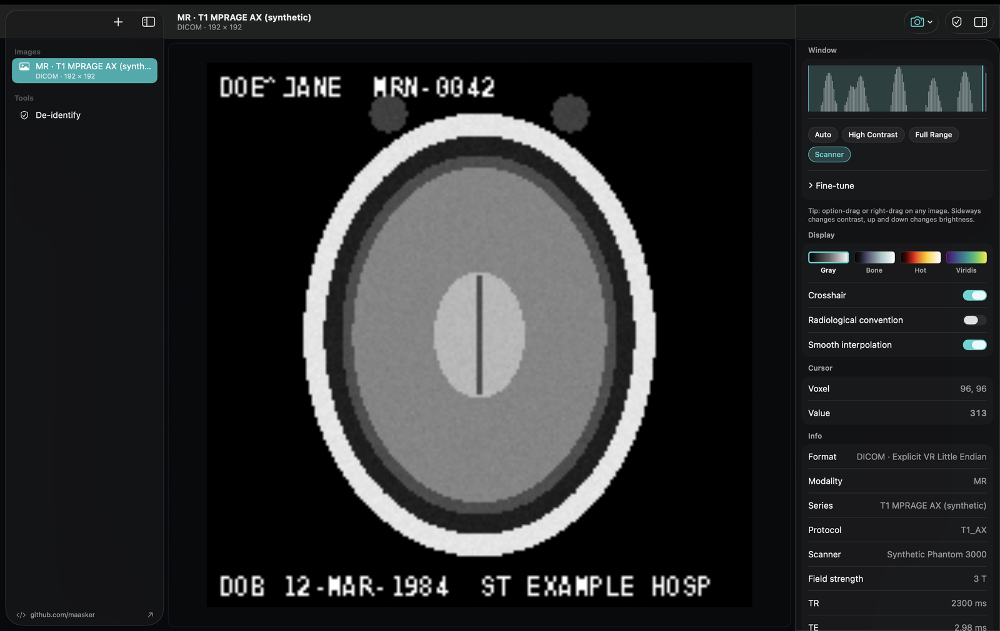
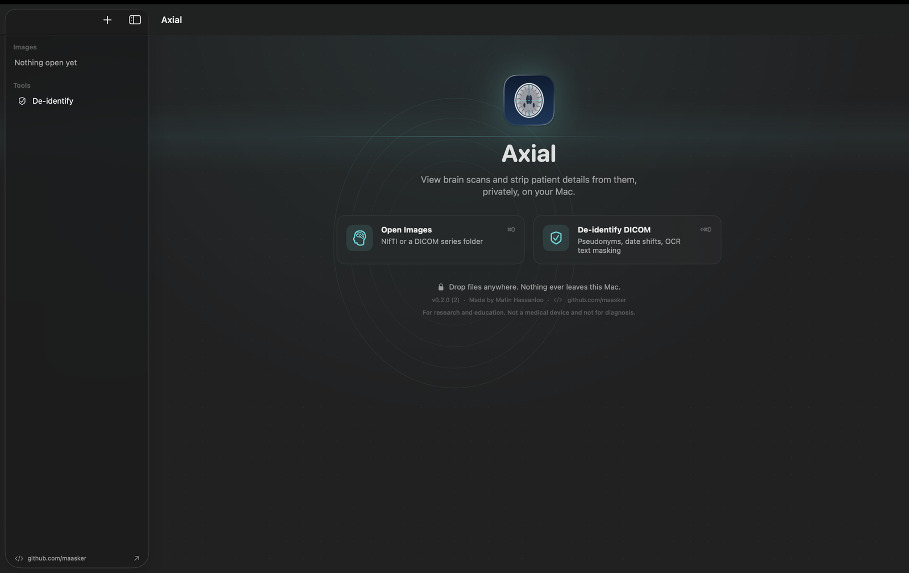

<p align="center">
  
</p>

<h1 align="center">Axial</h1>

<p align="center">
  <b>A native macOS MRI viewer with a built-in DICOM de-identifier.</b><br>
  View NIfTI and DICOM scans, then share them safely, all on your Mac.
</p>

<p align="center">
  
  
  
  <a href="https://github.com/maasker/Axial/actions"></a>
</p>

> [!IMPORTANT]
> Axial is for **research and education**. It is not a medical device and must not be used for diagnosis.
> Automatic de-identification can miss things. Always review the output before sharing data.

<p align="center">
  
</p>

<table>
  <tr>
    <td width="50%"></td>
    <td width="50%"></td>
  </tr>
  <tr>
    <td align="center"><sub>Viewer: window presets, colormaps and scan details</sub></td>
    <td align="center"><sub>Welcome screen</sub></td>
  </tr>
</table>

<p align="center"><sub>All screenshots use the synthetic phantom in <code>SampleData/</code>. The patient details are fake.</sub></p>

## Why

Researchers move between two jobs all the time: **looking** at scans, and **cleaning** them before they leave the
hospital. Most tools do only one of these, are cross-platform ports that don't feel like Mac apps, or send data to a
server. Axial does both, natively, and nothing ever leaves your machine.

## Features

### What's new in 0.2
- **Redesigned viewer**: rounded image tiles on a dark canvas, colour-coded planes and crosshair lines,
  floating labels, and a slice scrubber, slice counter and value readout that appear when you hover
- **Window preset chips** (Auto, High Contrast, Full Range, Scanner, plus Brain, Subdural, Soft Tissue and Bone for CT)
  and visual colormap swatches
- **Quick Look**: press Space on a `.nii` or `.dcm` file in Finder to preview it
- **De-identification report card**: a before/after slider over the image, summary stats, and a
  `deidentification-report.txt` audit file written with every export
- **New welcome screen** with an animated backdrop and **recent files**
- About window, drag-and-drop animation, and a Help menu with links to the project

### Viewer
- Opens **NIfTI-1** (`.nii`, `.nii.gz`) and **DICOM series** (whole folders, sorted by slice position)
- **Axial / coronal / sagittal** views with a linked crosshair, plus a **maximum-intensity projection** tile
- Correct anatomical orientation: data is reoriented to RAS+ from the NIfTI sform/qform or the DICOM patient geometry.
  Switch between **neurological and radiological** conventions
- Window/level by **option-drag or right-drag**, presets (Auto, Full Range, Scanner) and a live **histogram**
- Colormaps: Gray, Bone, Hot, Viridis
- Pointer readout in voxel **and world (mm)** coordinates
- Identifying header fields are **hidden by default** in the info panel
- Export the current slice as PNG at its true physical aspect ratio
- Double-click any view to maximise it. Scroll or use the arrow keys to move through slices

### De-identifier
- Based on the **DICOM PS3.15 Basic Confidentiality Profile**: removes or empties names, addresses, physicians,
  institutions, accession numbers, device serials and more, **including inside nested sequences**
- **Consistent pseudonyms** (`SUBJ-4F2A91C0`) and **consistent date shifting** per patient, so intervals between
  scans are preserved
- **UID replacement** with deterministic `2.25.…` UIDs, so references between files stay intact
- Removes **private tags**
- **Finds text burned into the pixels** with Apple's on-device Vision OCR and blacks it out
- A side-by-side **preview** of every change (original → de-identified) before anything is written
- One-click export to `Pseudonym/Series/IM00001.dcm`, optionally **also as NIfTI** (`.nii.gz`)
- An optional re-identification key (CSV), off by default
- A project key keeps pseudonyms identical across sessions and machines
- **Originals are never modified**

## Getting started

Requirements: macOS 14 Sonoma or later and Xcode 15 or later.

```bash
brew install xcodegen          # generates the .xcodeproj from project.yml
git clone https://github.com/maasker/Axial.git
cd Axial
xcodegen generate
open Axial.xcodeproj           # then press ⌘R
```

**Quick Look:** run the app once, then select a `.nii` or `.dcm` file in Finder and press Space.
If the preview doesn't appear, run `qlmanage -r` in Terminal to reload Quick Look plug-ins.
(`.nii.gz` can't have its own Quick Look preview, because macOS treats every `.gz` file as a generic archive.)

Try it with the synthetic data in [`SampleData/`](SampleData): open `phantom_t1.nii.gz`, then drop the
`dicom_phantom` folder onto **De-identify** to watch it remove the fake patient details and the burned-in text.

### Controls

| Action | How |
|---|---|
| Move the crosshair | Click or drag |
| Change slice | Scroll, or ↑ / ↓ |
| Window / level | Option-drag or right-drag (→ width, ↑ level) |
| Maximise a view | Double-click (again to restore) |
| Open files | ⌘O, or drop anywhere |
| De-identify | ⇧⌘D, or *De-identify Series* in the viewer toolbar |

## How it works

```
Axial/
├─ IO/             NIfTI-1 reader/writer, gzip, DICOM parser/writer, series → volume
│  └─ DICOM/
├─ Models/         Volume (RAS+ reorientation, stats), view models
├─ Rendering/      Plane geometry, slice extraction, MIP, colormaps
├─ Anonymizer/     Confidentiality profile, deterministic hashing, Vision OCR masking
└─ Views/          SwiftUI interface (AppKit for the slice canvas)
AxialQuickLook/    Finder Quick Look preview extension (shares the IO and rendering code)
```

- **No third-party dependencies.** The NIfTI and DICOM parsers are written from scratch in Swift, on top of
  Foundation, CryptoKit, Vision and Core Graphics.
- The DICOM writer keeps the original transfer syntax and writes sequences with undefined length, so edited files
  stay valid without recalculating nested lengths. Compressed pixel data is passed through untouched.
- Pseudonyms, date shifts and UIDs come from `SHA-256(project key | value)`, so results are reproducible.

## Limitations

- Viewing needs uncompressed DICOM (Explicit/Implicit VR Little Endian). Compressed files can still be
  de-identified (metadata only, with a warning), and single-frame JPEG/JPEG 2000 files can be previewed.
- Burned-in text detection is best-effort. Faint, rotated or very small text can be missed.
- De-identification covers the common attributes of the Basic Profile, not every attribute in the standard.
  Check that it meets your ethics or IRB requirements.
- 4-D NIfTI shows the first volume. NIfTI-2 and `.hdr/.img` pairs aren't supported yet.

## Roadmap

- [x] Quick Look extension (v0.2)
- [ ] On-device skull-stripping and segmentation with Core ML
- [ ] Overlays (load a label map on top of an anatomical image)
- [ ] Metal volume rendering
- [ ] Compressed transfer syntaxes (JPEG Lossless, JPEG 2000, RLE)
- [ ] Time-series scrubbing for 4-D data

## Contributing

Issues and pull requests are welcome. Please **never attach real patient data**; use the generator in
`SampleData/` to reproduce problems.

## License

[MIT](LICENSE) © 2026 Matin Hassanloo · [github.com/maasker](https://github.com/maasker)
